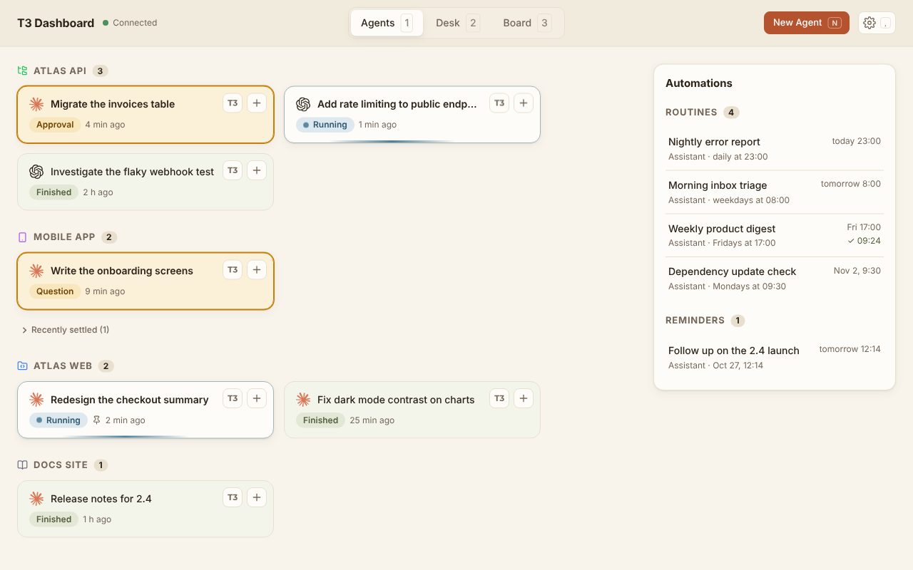
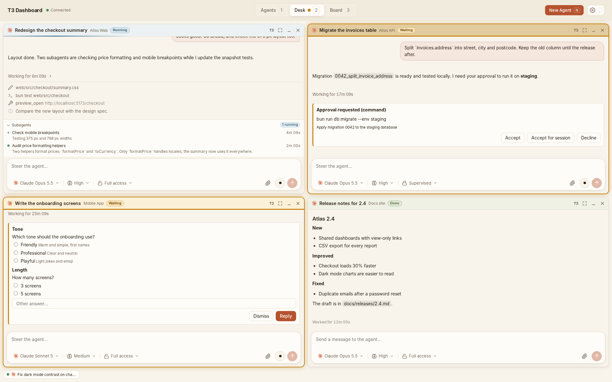
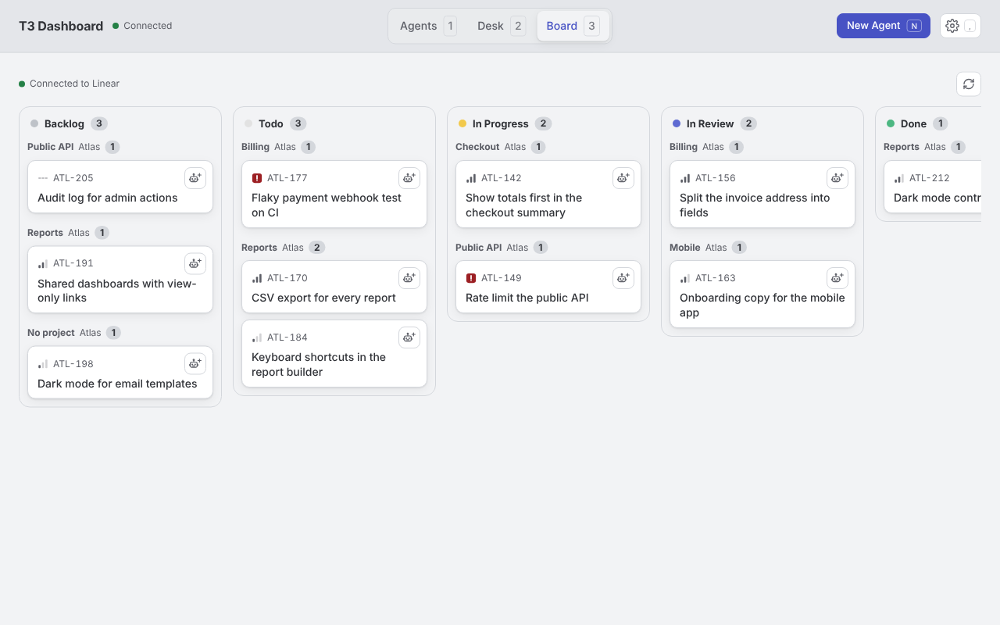
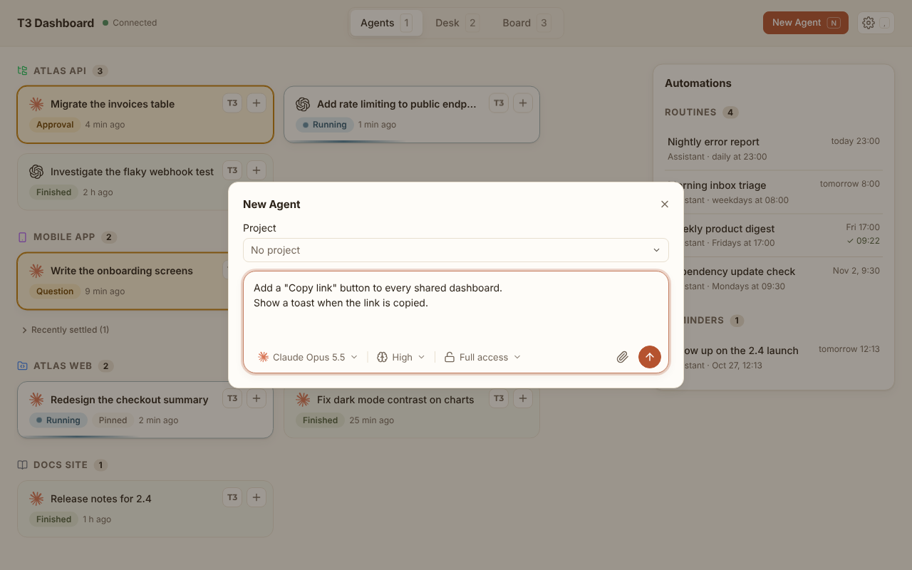

# t3-dashboard

t3-dashboard is a web dashboard on top of T3 Code. It shows all your Claude and Codex agents on one screen. You follow their work, reply to them and start new agents. The Board shows your Linear issues: one click gives an issue to an agent. The dashboard runs in the background on your computer and opens in your browser.

## Screenshots

| Agents | Desk |
| --- | --- |
|  |  |

| Board | New Agent |
| --- | --- |
|  |  |

The screenshots come from the demo mode: the projects, agents and conversations are invented.

## What you can do

**Agents**

- See one card per T3 Code session, grouped by project, with the project icon.
- See pinned agents first, then the agents that wait for a reply, then the agents that work.
- Open a conversation on the Desk with one click.
- Press Ctrl+K (Cmd+K on Mac) to search conversations by title, project or message, from any screen.

**Desk**

- Follow several conversations side by side. Six windows stay visible. When you open a seventh, the oldest one goes to the dock.
- Send a message, attach images, change the model, stop a run.
- Reply to the approvals and questions of the agents.
- See the images, videos and HTML pages that the agent shows.

**Board**

- See the Linear issues assigned to you, by status and by project.
- Give an issue to an agent: the New Agent window opens with the issue.

**Automations**

- See the routines and reminders of the t3-agent assistants, read-only.

The New Agent button (key `N`) starts an agent in a T3 project, or in "No project". It uses the default model and the favorites of T3 Code. Each screen is described in [docs/usage.md](docs/usage.md).

## Install

Requirement: T3 Code installed on the same computer.

macOS and Linux:

```sh
curl -fsSL https://raw.githubusercontent.com/simonzsh/t3-dashboard/main/install.sh | sh
```

Windows (PowerShell):

```powershell
irm https://raw.githubusercontent.com/simonzsh/t3-dashboard/main/install.ps1 | iex
```

The script downloads the binary and checks its SHA-256 sum. Then it registers a service that starts when you log in, and opens `http://127.0.0.1:4300`.

### First start

1. The dashboard creates its own access token for T3 Code. You do nothing.
2. If T3 Code is not running, a screen tells you. Start T3 Code, then click "Retry".
3. If the token cannot be created, the screen gives a command. Run it, then paste the token.
4. Optional: in the Board tab, paste a Linear API key to see your issues.

More details in [docs/install.md](docs/install.md).

## Connections

| System | Required | Use |
| --- | --- | --- |
| T3 Code local API | Yes | Reads the projects, sessions and conversations. Sends the messages, the replies and the new agents. |
| Linear API key | No | Reads the issues assigned to you, for the Board. |
| GitHub Releases | No | Looks for a new version and downloads it when you click. |
| t3-agent assistant files | No | Reads the routines and reminders. Never writes. |

## How it works

- The dashboard is a single binary. It contains the server and the interface.
- The server listens only on `127.0.0.1`. It has no authentication.
- The T3 token and the Linear key stay on the server. The browser never sees them.
- The server keeps a live connection to T3 Code. The interface updates live, without a page reload.

## Update

The dashboard looks for a new version every hour. When one is available, click the "Update vX.Y.Z" button in the header. In a terminal: `t3-dashboard update`.

## Uninstall

Run `t3-dashboard uninstall`, then delete the binary. The full procedure is in [docs/install.md](docs/install.md#désinstallation).

## Documentation

- [docs/install.md](docs/install.md): install, service, commands, updates, logs, Linear, environment variables, remote access.
- [docs/usage.md](docs/usage.md): screens, actions and keyboard shortcuts.
- [docs/development.md](docs/development.md): development with Bun, demo mode, checks, architecture, security.
- [docs/contracts.md](docs/contracts.md): contract checks against T3 Code, Linear, GitHub and t3-agent.
