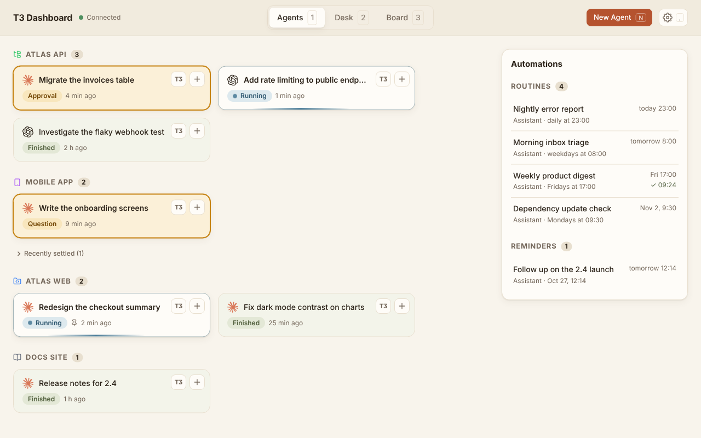
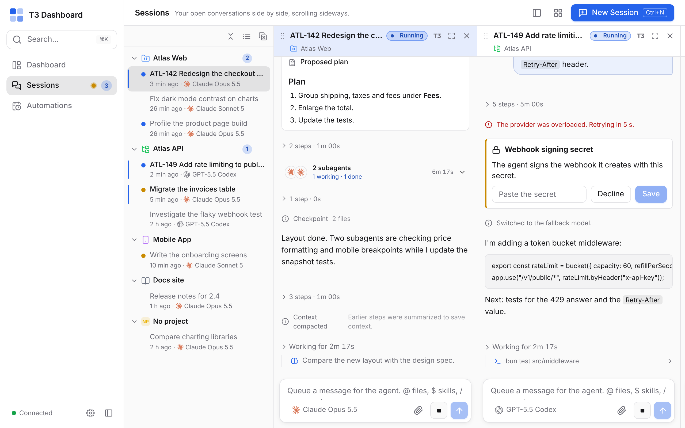
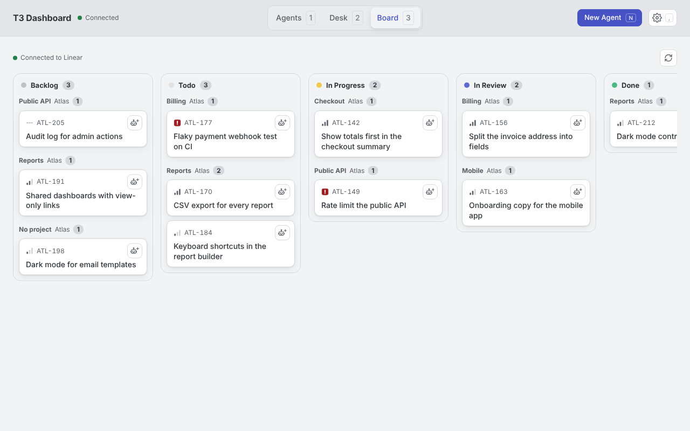
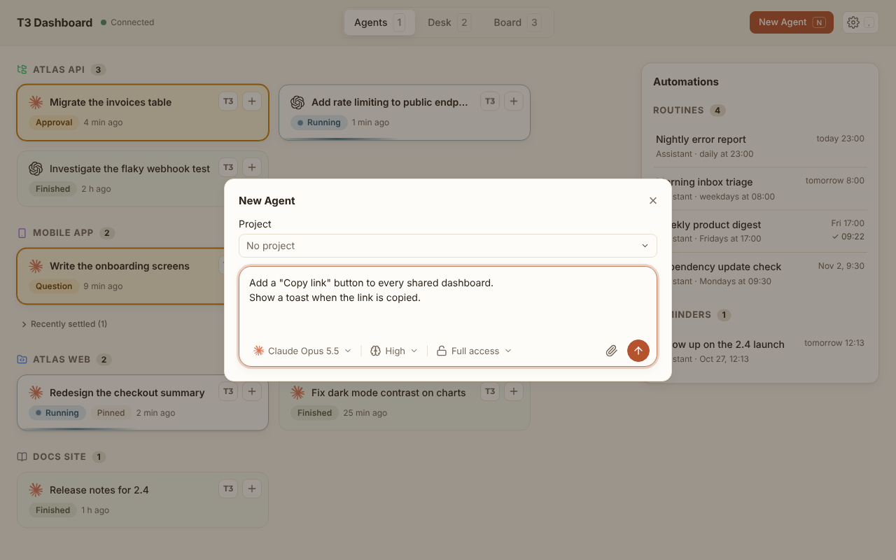
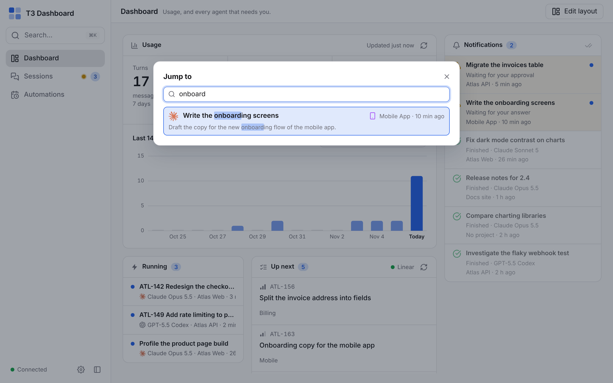

# t3-dashboard

t3-dashboard is a web dashboard on top of T3 Code. It shows all your Claude and Codex agents on one screen. You follow their work, reply to them and start new sessions. Home shows your usage, a Notifications card with what needs you, the running agents, what to relaunch and your next Linear tickets: you can assign a ticket to an agent or copy its link. The dashboard runs in the background on your computer and opens in your browser.

## Screenshots

| Agents | Sessions |
| --- | --- |
| <picture><source media="(prefers-color-scheme: dark)" srcset="docs/screenshots/agents-dark.png"></picture> | <picture><source media="(prefers-color-scheme: dark)" srcset="docs/screenshots/sessions-dark.png"></picture> |

| Board | New Session |
| --- | --- |
| <picture><source media="(prefers-color-scheme: dark)" srcset="docs/screenshots/board-dark.png"></picture> | <picture><source media="(prefers-color-scheme: dark)" srcset="docs/screenshots/new-agent-dark.png"></picture> |

| Jump to a conversation |
| --- |
| <picture><source media="(prefers-color-scheme: dark)" srcset="docs/screenshots/search-dark.png"></picture> |

The screenshots come from the demo mode: the projects, agents and conversations are invented. GitHub shows the light or dark variant to match your color scheme.

## What you can do

**Home**

- See what needs you at a glance: a Notifications card lists agents that wait for a reply or failed, and unread results. The Home entry in the sidebar shows the number of unread items. A usage card shows turns, sessions and spend for the last 7 days, and a chart of the last 14 days.
- See which Linear tickets to relaunch or to do next, assign a ticket to an agent or copy its link.
- Open a conversation in Sessions with one click.
- Press Ctrl+K (Cmd+K on Mac) to open the switcher and jump to a conversation by title, project or message, from any screen. The words you type are highlighted in the matching messages. Before you type, it suggests the agents that wait for you, then your recent ones.

**Sessions**

- Follow several conversations side by side, in columns that scroll sideways. Switch to a grid of two rows.
- Send a message, attach images, change the model, stop a run.
- Reply to the approvals and questions of the agents.
- See the images, videos and HTML pages that the agent shows.

**Automations**

- See the routines, reminders and webhooks (T3 Code scheduled tasks) in a table that you can search and filter by project, and create one with a form. The dashboard pauses a reminder after its run and keeps tasks out of worktrees.

The New Session button (key `N`) starts a session in a T3 project, or in "No project". It uses the default model and the favorites of T3 Code. Each screen is described in [docs/usage.md](docs/usage.md).

## Install

Requirement: T3 Code installed on the same computer.

macOS and Linux:

```sh
curl -fsSL https://raw.githubusercontent.com/simonzsh/t3-dashboard/main/install.sh | sh
```

Windows (PowerShell):

```powershell
irm https://raw.githubusercontent.com/simonzsh/t3-dashboard/main/install.ps1 | iex
```

The script downloads the binary and checks its SHA-256 sum. Then it registers a service that starts when you log in, and opens `http://127.0.0.1:4300`.

### First start

1. The dashboard creates its own access token for T3 Code. You do nothing.
2. If T3 Code is not running, a screen tells you. Start T3 Code, then click "Retry".
3. If the token cannot be created, the screen gives a command. Run it, then paste the token.
4. Optional: on the Home page, paste a Linear API key to see your tickets.

More details in [docs/install.md](docs/install.md).

## Connections

| System | Required | Use |
| --- | --- | --- |
| T3 Code local API | Yes | Reads the projects, sessions, conversations and scheduled tasks. Sends the messages, the replies and the new agents. |
| Linear API key | No | Reads the issues assigned to you, for the Inbox. |
| GitHub Releases | No | Looks for a new version and downloads it when you click. |

## How it works

- The dashboard is a single binary. It contains the server and the interface.
- The server listens only on `127.0.0.1`. It has no authentication.
- The T3 token and the Linear key stay on the server. The browser never sees them.
- The server keeps a live connection to T3 Code. The interface updates live, without a page reload.

## Update

The dashboard looks for a new version every hour. When one is available, click the "Update vX.Y.Z" button in the header. In a terminal: `t3-dashboard update`.

## Uninstall

Run `t3-dashboard uninstall`, then delete the binary. The full procedure is in [docs/install.md](docs/install.md#uninstall).

## Documentation

- [docs/install.md](docs/install.md): install, service, commands, updates, logs, Linear, environment variables, remote access.
- [docs/usage.md](docs/usage.md): screens, actions and keyboard shortcuts.
- [docs/development.md](docs/development.md): development with Bun, demo mode, checks, architecture, security.
- [docs/contracts.md](docs/contracts.md): contract checks against T3 Code, Linear and GitHub.
